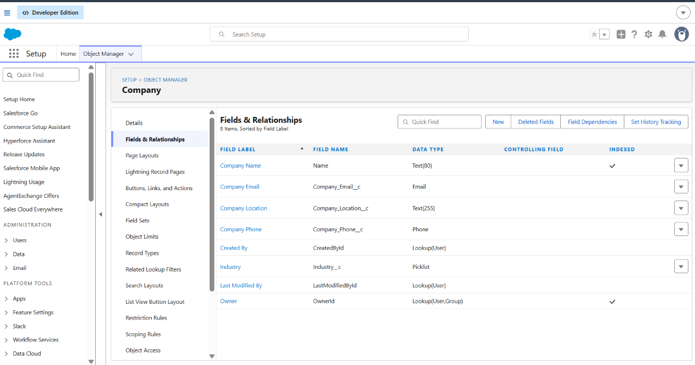
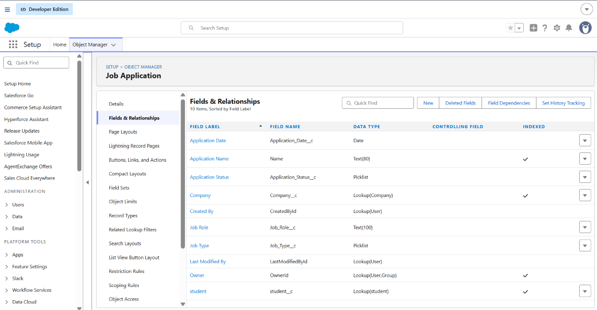
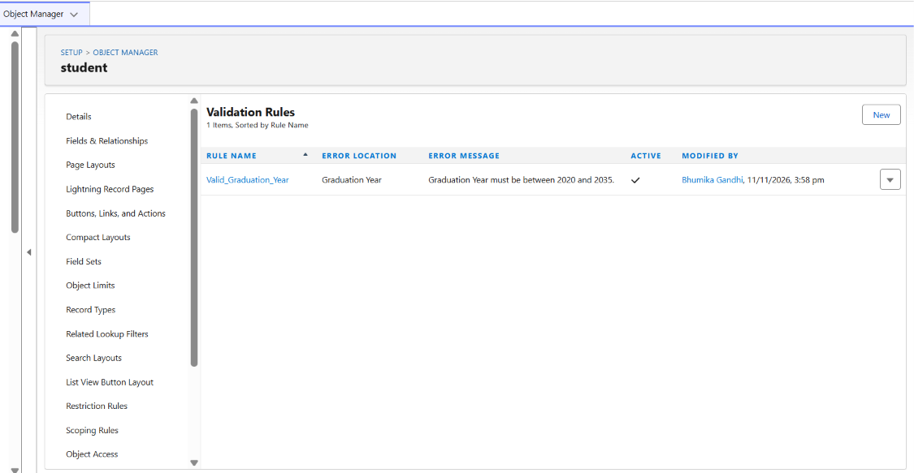
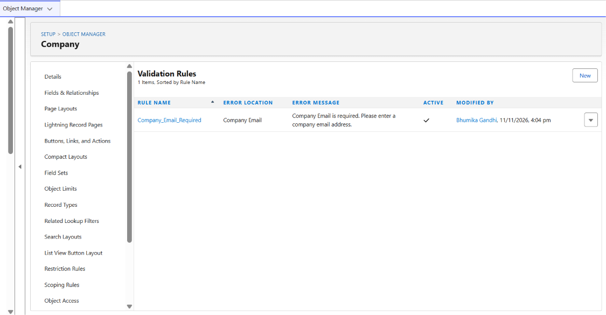
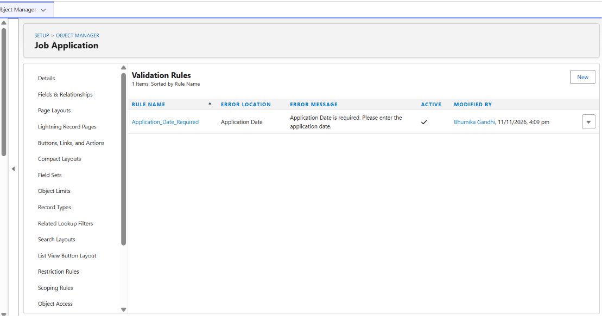

# Student Placement Management System

## About the Project
A Salesforce-based CRM project designed to manage student placement records, companies, and job applications.

## Features
- Custom Objects: Student, Company, and Job Application
- Lookup Relationships between objects
- Record-Triggered Flow for automatic placement status updates
- Validation Rules for data accuracy
- Reports for placement tracking
- Dashboard with charts and insights

## Technologies Used
- Salesforce Developer Edition
- Salesforce Flow
- Custom Objects and Fields
- Reports and Dashboards
- Validation Rules

## Project Type
Salesforce CRM Portfolio Project

## Project Screenshots

### Dashboard

### Automation Flow

### Student Object

### Company Object

### Job Application Object

### Validation Rules

